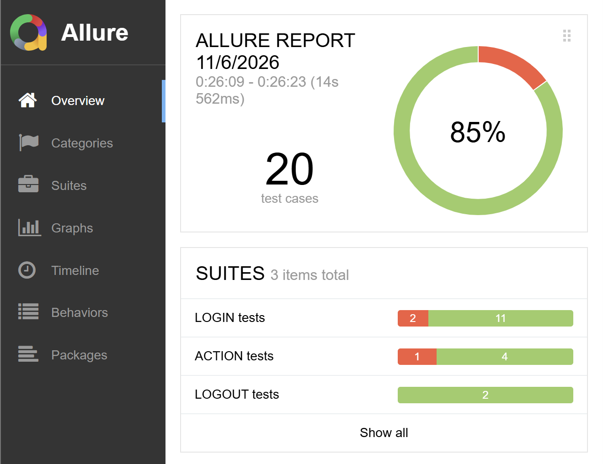

# Nord Codes API tests

## Getting Started
1. [Download](https://drive.google.com/file/d/1BLi-R2426t3a34uAMsp-hM-Gz_iZb_KZ/view?usp=sharing) and run the tested service.
```shell
java -jar -Dsecret=qazWSXedc -Dmock=http://localhost:8888/ internal-0.0.1-SNAPSHOT.jar
```
2. Clone this project.
```shell
git clone https://github.com/NadChel/qa-nord-codes
```
3. Navigate to this project's root and execute the command below. It will run the tests, build and open an Allure report in your default browser. Press Ctrl+C to terminate the process.
```shell
mvn verify
```

<small>*Allure report*</small>